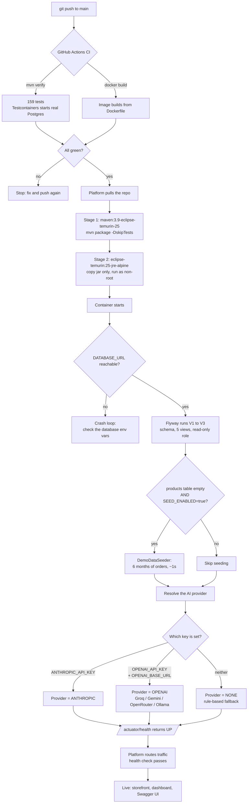

# Deploying ShopPulse

Everything here is a container plus a Postgres URL. If a platform can run those two things,
ShopPulse runs on it.

---

## 1. The deployment flow



The branch at `N` is the important one for a demo: **a missing API key is a supported
configuration, not a failure**. The app boots, the dashboard works, and every AI response
carries `aiGenerated: false` plus a visible "rule-based fallback" badge.

---

## 2. Required and optional configuration

| Variable | Required | Default | Notes |
|---|---|---|---|
| `DATABASE_URL` | **yes** | local Postgres | JDBC form: `jdbc:postgresql://host:5432/db` |
| `DATABASE_USER` / `DATABASE_PASSWORD` | yes (unless in the URL) | `shoppulse` | |
| `JWT_SECRET` | **yes in production** | dev value | ≥ 32 bytes; the app refuses to start on a shorter one |
| `PORT` | no | `8080` | most platforms inject this |
| `SEED_ENABLED` | no | `true` | set `false` for a real deployment with real data |
| `AI_PROVIDER` | no | `auto` | `auto` \| `anthropic` \| `openai` \| `none` |
| `ANTHROPIC_API_KEY` | no | `not-set` | enables the Anthropic path |
| `OPENAI_API_KEY` / `OPENAI_BASE_URL` / `OPENAI_MODEL` | no | `not-set` / OpenAI / `gpt-4o-mini` | any OpenAI-compatible endpoint |
| `AI_READONLY_DATABASE_URL` | no | empty | least-privilege connection for AI SQL |
| `BRIEFING_CRON` | no | `0 0 7 * * MON` | weekly briefing schedule |

> **One warning worth repeating:** `JWT_SECRET` has a development default so `docker compose up`
> works with no setup. Any deployment reachable from the internet must override it. `render.yaml`
> uses `generateValue: true` so Render does this for you.

---

## 3. Running it

### Local, everything included

```bash
docker compose up
```

Postgres, migrations, six months of seed data, app on `:8080`. No credentials needed.

### Render (the `render.yaml` in this repo)

1. Push to GitHub.
2. Render → New → Blueprint → pick the repo. It reads `render.yaml`, creates the web service
   and a managed Postgres, wires `DATABASE_URL`, and generates `JWT_SECRET`.
3. Optional: add an AI key in the dashboard (see section 4).

Free-tier Postgres and free-tier web services both sleep when idle, so the first request after
a quiet period takes a few seconds. Worth saying out loud in an interview before someone clicks
the link and thinks it's broken.

### Railway / Fly.io / anything that takes a container

```bash
docker build -t shoppulse .
docker run -p 8080:8080 \
  -e DATABASE_URL='jdbc:postgresql://host:5432/shoppulse' \
  -e DATABASE_USER=... -e DATABASE_PASSWORD=... \
  -e JWT_SECRET="$(openssl rand -base64 48)" \
  shoppulse
```

Health check path: `/actuator/health`. Give it a 60-second start period — Flyway and seeding
run before the port opens.

---

## 4. Running the AI features without paying

The AI module talks to exactly one class, `ChatGateway`, and `AiAvailability` decides which
backend that class uses. Because `spring-ai-starter-model-openai` speaks the OpenAI wire
protocol, **any provider with an OpenAI-compatible endpoint works by changing three environment
variables and nothing else.** That covers most free tiers.

Limits below were published as of November 2026 and providers change them without notice —
check the provider's own page before relying on a number.

### Option A — Groq (recommended free option)

Fast, no card required, clearly published limits, and its terms do not claim training rights
over API data.

```bash
AI_PROVIDER=openai
OPENAI_API_KEY=gsk_...                              # console.groq.com/keys
OPENAI_BASE_URL=https://api.groq.com/openai/v1
OPENAI_MODEL=openai/gpt-oss-120b
```

Free plan on `gpt-oss-120b`: about 30 requests/min, 1,000 requests/day, 8K tokens/min,
200K tokens/day. The tokens-per-minute cap is the binding one here — ShopPulse's prompts are
small (a schema description plus a question), so this is comfortable for a demo.

### Option B — Google Gemini free tier

Widest free model range, via Google's OpenAI compatibility layer.

```bash
AI_PROVIDER=openai
OPENAI_API_KEY=AIza...                              # aistudio.google.com/apikey
OPENAI_BASE_URL=https://generativelanguage.googleapis.com/v1beta/openai
OPENAI_MODEL=gemini-2.5-flash
```

Caveat to know before you put a store's data through it: Google's terms say content sent to
the **unpaid** tier can be used to improve their products, and may be read by human reviewers.
Fine for seeded demo data, not for anything real. (ShopPulse masks customer emails before any
model call regardless — see `PiiMasker`.)

### Option C — OpenRouter free models

One key, many models, IDs ending in `:free`.

```bash
AI_PROVIDER=openai
OPENAI_API_KEY=sk-or-...                            # openrouter.ai/keys
OPENAI_BASE_URL=https://openrouter.ai/api/v1
OPENAI_MODEL=google/gemma-3-27b-it:free
```

About 20 requests/min and 50 requests/day without credit, rising to 1,000/day after a one-off
$10 top-up. Failed attempts count toward the cap, and the free model list rotates, so pin a
model you have tested and keep the fallback path working.

### Option D — fully local with Ollama (no key, no quota, no data leaving the machine)

```bash
ollama pull llama3.1:8b && ollama serve

AI_PROVIDER=openai
OPENAI_API_KEY=ollama                 # any non-empty value; Ollama ignores it
OPENAI_BASE_URL=http://localhost:11434/v1
OPENAI_MODEL=llama3.1:8b
```

From inside Docker, use `http://host.docker.internal:11434/v1`.

Honest note on quality: an 8B local model writes noticeably worse SQL than a frontier model.
This is the configuration where `SqlGuard` earns its keep — it rejects the malformed and
unsafe attempts, and the request falls through to the built-in query library rather than
failing. Worth demonstrating deliberately.

### Option E — no key at all (the default)

Leave everything unset. `AiAvailability` resolves to `NONE`, and:

- **Ask your store** matches the question against a 7-intent library of pre-written,
  parameterised SELECTs over the views, runs one, and summarises the rows deterministically.
- **Weekly briefing** writes its five bullets from the same computed numbers, recording the
  model as `rule-based`.
- **Anomaly explanation** states the arithmetic: this day versus the trailing 28-day average,
  which categories moved, which products moved.

Every response sets `aiGenerated: false` and the dashboard shows a badge saying so. Nothing
pretends to be a model.

---

## 5. Checking a deployment

```bash
BASE=https://your-app.onrender.com

curl -s $BASE/actuator/health                       # {"status":"UP"}

TOKEN=$(curl -s -X POST $BASE/api/v1/auth/login \
  -H 'Content-Type: application/json' \
  -d '{"email":"merchant@shoppulse.dev","password":"merchant123"}' \
  | python3 -c 'import sys,json;print(json.load(sys.stdin)["token"])')

curl -s $BASE/api/v1/merchant/analytics/kpis -H "Authorization: Bearer $TOKEN"

# Which AI mode is live? Look at aiGenerated in the response.
curl -s -X POST $BASE/api/v1/merchant/ai/ask \
  -H "Authorization: Bearer $TOKEN" -H 'Content-Type: application/json' \
  -d '{"question":"How did revenue trend over the last 30 days?"}'
```

The startup log prints `AI provider resolved to ANTHROPIC|OPENAI|NONE`, which is the quickest
way to confirm the keys arrived.

---

## 6. Things that will bite you

| Symptom | Cause | Fix |
|---|---|---|
| Crash loop at startup, Flyway error | `DATABASE_URL` not in JDBC form | must start `jdbc:postgresql://`; Render's `connectionString` is already correct |
| `Validation failed for query ... schema-validation` | database has an older schema | Hibernate is set to `validate`; let Flyway migrate, never hand-edit tables |
| App starts, dashboard is empty | `SEED_ENABLED=false`, or the products table is already non-empty | seeding only runs on an empty catalogue, by design, so restarts don't duplicate data |
| First request takes 20 seconds | free-tier container and database were asleep | expected on free plans; warm it before a demo |
| AI answers are all `aiGenerated: false` | no key reached the container | check the startup log line; `AI_PROVIDER=auto` ignores a key set under the wrong variable |
| 429 from `/ai/ask` | the built-in token bucket (20 questions/min) | deliberate, so a demo cannot burn an API budget |
| Migration `V3` logs "insufficient privileges" | managed Postgres won't let you `CREATE ROLE` | harmless and handled; the Java-side SQL guards still apply |
